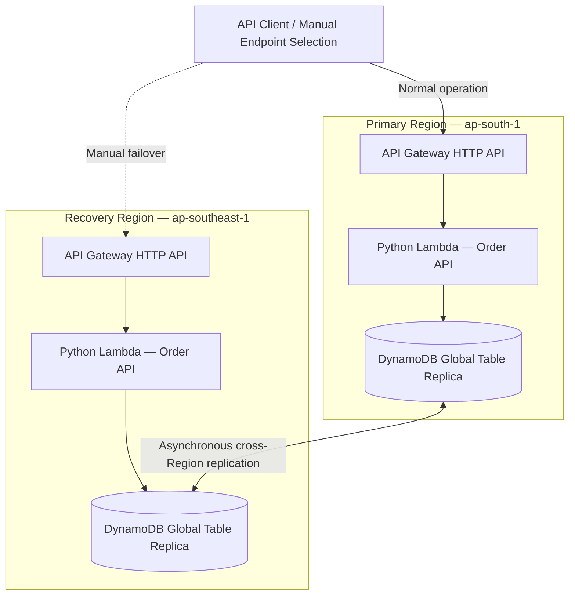

# AWS Multi-Region Disaster Recovery & Resilience Lab

A cost-conscious, infrastructure-as-code proof of concept demonstrating **application-level disaster recovery across two AWS Regions** using API Gateway, AWS Lambda, and DynamoDB Global Tables. The exercise validates regional service independence, bidirectional data replication, controlled primary application failure, manual recovery to a secondary Region, and failback.

> **Scope:** Technical POC using synthetic order records. This is not a production-ready disaster recovery implementation or a simulation of an actual AWS Region outage.

## Architecture



Both Regions have independently deployed HTTP APIs and Lambda functions. Each Lambda reads from and writes to its **local regional DynamoDB replica**. The application uses regional API Gateway invoke URLs for testing; no global traffic-management layer is deployed.

### Implemented AWS components

| Component | Implementation | Purpose |
|---|---|---|
| API Gateway | Regional HTTP API, `$default` stage, Lambda proxy integration | Independent regional application entry points |
| Lambda | Python 3.12, identical application package in each Region | Stateless order API |
| DynamoDB Global Tables | On-demand billing; replicas in Mumbai and Singapore; eventual cross-Region replication | Regional data access and replication |
| DynamoDB Streams | `NEW_AND_OLD_IMAGES` | Supports Global Tables replication configuration |
| DynamoDB PITR | Configured in the Terraform lab for primary and replica | Point-in-time data recovery |
| IAM | Regional Lambda execution roles; `GetItem`/`PutItem` access scoped to regional table ARN | Least-privilege application access |
| Terraform | AWS provider aliases and reusable regional API module | Repeatable deployment and teardown |
| CloudWatch Logs | Lambda basic execution logging | Function-level diagnostics |

## Application API

| Method | Route | Behavior |
|---|---|---|
| `GET` | `/health` | Returns service health and current AWS Region |
| `POST` | `/orders` | Creates a UUID-based order with `CREATED` status, origin Region, and UTC timestamp |
| `GET` | `/orders/{order_id}` | Reads an order from the local regional replica; returns `404` if absent |

Order writes are acknowledged by the local DynamoDB replica. Replication to the other Region is **asynchronous**; a remote read immediately after a write may temporarily return `404`. A strongly consistent read against a regional replica does not provide cross-Region strong consistency.

## Repository structure

```text
aws-dr-resilience-lab/
├── application/
│   └── lambda/
│       └── handler.py
├── terraform/
│   ├── environments/
│   │   └── dr-lab/
│   │       ├── main.tf
│   │       ├── dynamodb.tf
│   │       └── ...
│   └── modules/
│       └── regional-api/
│           └── ...
└── README.md
```

The environment configures provider aliases for `ap-south-1` and `ap-southeast-1`, instantiates the regional API module twice, packages the Lambda handler with Terraform's `archive_file` data source, and manages the DynamoDB Global Table. The module provisions each Region's API Gateway, Lambda, IAM permissions, and routes. File names represented by `...` depend on the repository's actual Terraform layout.

## DR strategy and architecture decisions

**Topology:** Active-passive at the **application traffic** layer, with both regional API stacks deployed and capable of accepting requests. DynamoDB Global Tables supports writes in both Regions; this POC does not enforce a single-writer policy at the database layer.

**Recovery operation:** A client or operator changes the API endpoint from Mumbai to Singapore after identifying primary application failure. No Route 53 failover, health-check-based routing, Global Accelerator, or other automatic traffic steering is implemented.

**Data protection:** Asynchronous Global Tables replication allows the secondary application to access replicated records and continue accepting writes. PITR provides a separate recovery mechanism for data mistakes but is not a substitute for replication monitoring, restore drills, or a tested backup policy.

**Cost decisions:** Lambda and API Gateway avoid always-on compute, and DynamoDB uses on-demand capacity. The POC avoids EKS clusters, NAT gateways, and continuously running instances. DynamoDB replica storage, replicated writes, PITR, requests, and logging can still incur charges while deployed.

**Trade-offs:** The design prioritizes low operational overhead and fast regional redeployment. It does not address application session continuity, global client routing, simultaneous write conflicts, business transaction idempotency, or regional dependency failures beyond the demonstrated components.

## Recovery objectives

| Objective | POC target | Validation status |
|---|---|---|
| RTO | 15 minutes | **Not conclusively measured**; the failure-start timestamp and full operator switchover interval were not captured |
| RPO | 5 minutes | **Not conclusively measured**; selected acknowledged writes were verified in the secondary Region, but no continuous write timeline or last-recoverable-write analysis was recorded |

RTO is measured from the time a service becomes unavailable to the time the application is restored for its intended clients. The Singapore validation sequence completed in approximately **one second** (17:34:01–17:34:02 UTC), but this is **validation duration, not end-to-end RTO**. No measured RPO or zero-data-loss guarantee is claimed.

## Game-day test and observed results

A controlled primary application failure was exercised using a Lambda reserved-concurrency override, which can prevent new invocations of the Mumbai Lambda. The secondary endpoint was tested directly, followed by restoration of the primary application and verification of reverse replication.

| Scenario | Observed result |
|---|---|
| Create order in Mumbai, read in Singapore | Passed |
| Create order in Singapore, read in Mumbai | Passed |
| Singapore health check during recovery validation | HTTP `200` |
| Read pre-existing Mumbai order through Singapore | HTTP `200` |
| Create new order through Singapore | HTTP `201` |
| Read Singapore-created recovery order in restored Mumbai | HTTP `200` |
| Terraform drift check after restoration | `No changes. Your infrastructure matches the configuration.` |

The Singapore recovery checks occurred between **17:34:01 and 17:34:02 UTC** during the game day. A subsequent Mumbai read returned the Singapore-created order successfully. The provided results demonstrate regional application functionality and data replication; the full timestamped primary failure detection and client redirection path was not captured in the recorded evidence.

### Failure-injection limitations

- Throttling a single Lambda function simulates an **application-layer outage**, not loss of an AWS Region.
- Directly invoking the secondary URL demonstrates recoverability, but does not validate DNS propagation, automatic failover, or existing client behavior.
- Cross-Region replication was confirmed for selected records, not measured as a sustained replication-lag distribution under load.
- A successful failback read demonstrates the tested record replicated back; it does not establish correctness under conflicting concurrent writes.

## Deployment and verification

Prerequisites: Terraform, AWS CLI, credentials authorized to create the resources, and AWS access to both Regions. Review Terraform variables and IAM privileges before deployment.

```bash
cd terraform/environments/dr-lab
terraform init
terraform fmt -recursive
terraform validate
terraform plan
terraform apply
```

Use the Terraform outputs for the two regional API URLs (do not commit or publish actual endpoints):

```bash
MUMBAI_URL=$(terraform output -raw mumbai_api_url)
SINGAPORE_URL=$(terraform output -raw singapore_api_url)

curl -sS "$MUMBAI_URL/health"
curl -sS "$SINGAPORE_URL/health"
curl -sS -X POST "$MUMBAI_URL/orders"
# Use the returned order_id to read the replicated record:
curl -sS "$SINGAPORE_URL/orders/<order-id>"
```

Allow for asynchronous replication when verifying newly created records.

### Cleanup

> **Destructive operation:** Destroying the DynamoDB Global Table deletes the lab's order records. Verify that the Terraform state is scoped to this POC before proceeding.

```bash
cd terraform/environments/dr-lab
terraform plan -destroy
terraform destroy
terraform state list
```

Confirm the table and Lambda functions are absent in both Regions, and review API Gateway resources, Lambda-created CloudWatch log groups, and any resources created outside Terraform. `terraform destroy` does not necessarily remove automatically created log groups or external state storage. Do not commit `.tfstate`, `.tfvars` containing secrets, `.terraform/`, generated ZIPs, or cloud credentials.

## Production-hardening roadmap

1. **Automated traffic failover:** Region-specific custom domains, Route 53 health checks and failover records (or Global Accelerator), and controlled failback; validate end-user recovery and DNS behavior.
2. **Quantitative RTO/RPO testing:** Timestamped continuous writes, health probes, recovery automation, replication-lag monitoring, repeated failure drills, and evidence-based objective reporting.
3. **API security:** Authentication and authorization, WAF where appropriate, throttling, schema validation, input limits, and protection from public unauthenticated writes.
4. **Data consistency:** Idempotency keys, conditional writes, ownership/single-writer strategy where appropriate, conflict-handling tests, and business-level reconciliation after failover.
5. **Observability:** CloudWatch metrics, structured logs, alarms, tracing, synthetic probes, dashboards, and operator notification/runbooks.
6. **Backup and restoration:** Independent backup policy, restore exercises in each Region, PITR retention review, and safeguards against accidental deletion or replicated corruption.
7. **Operational resilience:** Infrastructure and dependency isolation, capacity/quotas, deployment rollback, automated game days, chaos scenarios, and periodic DR reviews.
8. **Terraform security and state:** Remote encrypted state with locking and access controls, CI validation, drift detection, and explicit lifecycle protection for production data.

## Security and publication notes

This README intentionally omits AWS account identifiers, table and resource deployment IDs, API invoke URLs, API keys, cloud credentials, and internal environment-specific identifiers. The published examples use synthetic data and placeholders only.

**Status:** Functional two-Region application/data recovery POC validated; automatic traffic failover and conclusive RTO/RPO measurement remain future work. Infrastructure can be destroyed after testing to avoid ongoing lab charges.
